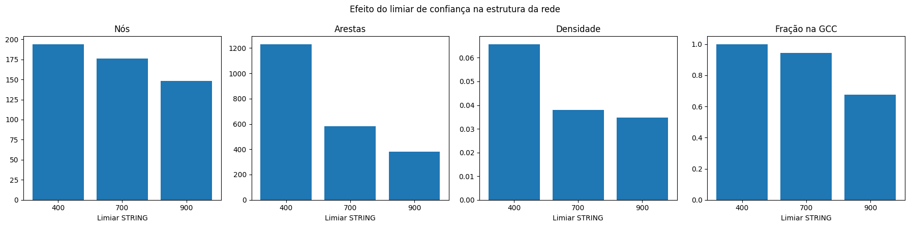
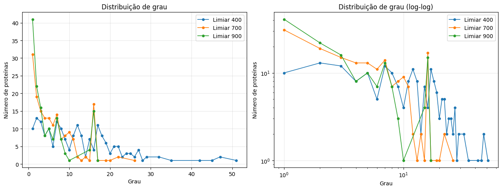
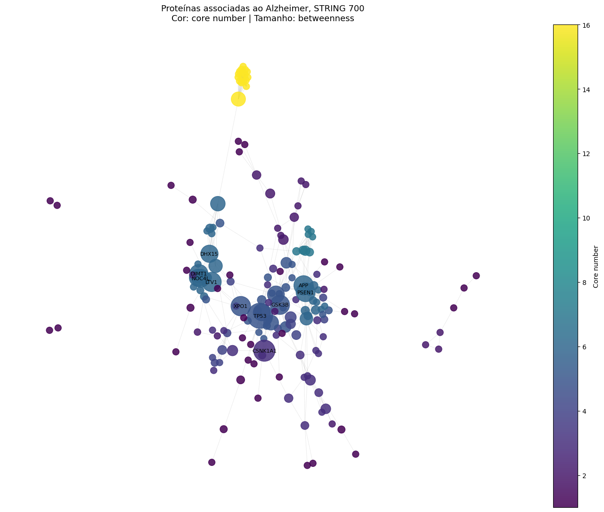

# Análise de Redes de Proteínas Associadas à Doença de Alzheimer

Projeto da Unidade 01 de Algoritmos e Estrutura de Dados II (Grafos), UFRN.

## Integrantes

Edson Maciel de Barros Junior

## Vídeo

> https://drive.google.com/file/d/1NpAlp0DTe1-18BBkrEbT-otdgsuK05OF/view?usp=sharing

## Problema e pergunta

A doença de Alzheimer está associada a alterações em diversas proteínas. Representar as interações entre essas proteínas como uma rede permite analisar a posição estrutural de cada uma e apontar candidatas a investigação.

**Pergunta de pesquisa:** entre as proteínas associadas à doença de Alzheimer, quais ocupam posições estruturais importantes na rede, atuando como hubs, pontes entre grupos ou integrantes de núcleos densos?

**Quem se beneficia:** pesquisadores que precisam priorizar proteínas-alvo para estudo, a partir de uma leitura estrutural da rede.

## Dados

### Fonte 1: genes associados ao Alzheimer

* **Plataforma:** Open Targets Platform
* **Doença:** Alzheimer disease (`MONDO_0004975`)
* **Página:** https://platform.opentargets.org/disease/MONDO_0004975/associations
* **Data de acesso:** 14/10/2026
* **Critério de seleção:** os 200 genes com maior `Association Score`
* **Arquivo:** `dados/genes_alzheimer.csv` (coluna `symbol` usada como identificador)

### Fonte 2: interações entre proteínas

* **Plataforma:** STRING Database (https://string-db.org/)
* **Obtenção:** API `network` do STRING, espécie humana (`species=9606`), enviando os 200 genes da Fonte 1. O notebook faz o download automaticamente.
* **Limiares de confiança testados** (`required_score`, escala 0 a 1000): 400 (médio), 700 (alto) e 900 (altíssimo).
* **Arquivos gerados:** `dados/string_400.tsv`, `dados/string_700.tsv`, `dados/string_900.tsv`
* **Data de acesso:** 14/10/2026 *(ajustar para a data em que o notebook foi executado)*

### Limpeza e tratamento

* Seleção dos 200 primeiros genes únicos, sem valores vazios.
* Conversão do `score` para número; linhas sem nome de proteína ou score são descartadas.
* O `score` devolvido pela API está na escala 0 a 1 (só o parâmetro `required_score` usa 0 a 1000).
* Autoarestas removidas.
* A rede é construída a partir das arestas, então genes sem nenhuma interação acima do limiar **não entram no grafo**. O número de genes fora da rede em cada limiar está na tabela de resultados.

## Modelagem da rede

| Elemento | Definição |
|---|---|
| **Nó** | proteína correspondente a um gene associado ao Alzheimer |
| **Aresta** | interação funcional entre duas proteínas, segundo o STRING |
| **Peso** | *combined score* do STRING (0 a 1): quanto maior, mais confiável a interação |
| **Direção** | não dirigido (o STRING agrega evidências simétricas) |
| **Custo (para betweenness)** | `1 - score`: interação mais confiável equivale a aresta mais "curta" |

**O que fica de fora:** contexto específico de tecido, distinção entre interação física e funcional, e proteínas fora dos 200 genes selecionados (inclusive as que mediariam interações indiretas).

**Ponto de atenção:** o *combined score* do STRING inclui evidência de mineração de texto, o que favorece genes muito estudados (ver Limitações).

## Conteúdo do curso utilizado

Todas as referências são ao arquivo `analise.ipynb`.

| Conceito | Semana | Onde aparece | Para que serviu |
|---|---|---|---|
| Grafo não dirigido ponderado, atributos de aresta | 2 | Seção 4 | Representar proteínas e interações com o score como peso |
| Grau e distribuição de grau | 2 | Seções 5, 6 e 7 | Identificar hubs; discutir cauda pesada (escala linear e log-log) |
| Densidade | 2 | Seção 5 e figura de comparação (seção 10) | Medir a conectividade geral e comparar limiares |
| Componentes conexos (GCC) | 4 | Seção 5 | Verificar se a rede é conexa e definir onde calcular as centralidades |
| Clustering e triângulos | 4 | Seção 5 | Avaliar a coesão local de cada proteína |
| Betweenness (ponderada) | 4 | Seções 5, 7, 8 e 10 | Identificar proteínas-ponte entre regiões da rede |
| Centralidade de eigenvector | 4 | Seção 5 | Identificar proteínas ligadas a outras proteínas centrais |
| K-core e core number | 5 | Seções 5 e 10 | Identificar o núcleo denso; colorir o grafo |

## Como executar

```bash
git clone <URL-do-repositório>
cd <pasta-do-repositório>
pip install -r requirements.txt
jupyter notebook analise.ipynb
```

No notebook, use **Reiniciar e executar tudo**. Ele baixa o CSV de genes e as interações do STRING (precisa de internet na primeira execução; depois reaproveita os arquivos de `dados/`) e gera as pastas `resultados/` e `figuras/`.

Também roda no Google Colab: abra o notebook, execute todas as células.

**Estrutura do repositório**

```
README.md
requirements.txt
analise.ipynb
dados/        genes_alzheimer.csv, string_400.tsv, string_700.tsv, string_900.tsv
resultados/   tabelas de métricas, resumo das redes, robustez, validação
figuras/      distribuicao_grau.png, grafo_string_700.png, comparacao_limiares.png
```

## Resultados

Todos os números abaixo vêm do `analise.ipynb` e estão em `resultados/`. O limiar principal é **700** (confiança alta); os limiares 400 e 900 servem para testar a robustez.

### Estrutura das redes por limiar

| Limiar | Nós | Genes fora da rede | Arestas | Densidade | Componentes | Nós na GCC | Fração na GCC | Core máximo |
|---|---|---|---|---|---|---|---|---|
| 400 | 194 | 6 | 1231 | 0,066 | 1 | 194 | 100% | 16 |
| 700 | 176 | 24 | 584 | 0,038 | 4 | 166 | 94,3% | 16 |
| 900 | 148 | 52 | 379 | 0,035 | 13 | 100 | 67,6% | 15 |



Quanto mais exigente o limiar, menor e mais fragmentada a rede: em 400 ela é conexa, em 700 quase toda (94%) está na maior componente, e em 900 sobram 13 componentes e só 68% dos nós na GCC. Em 900, 52 dos 200 genes (26%) ficam sem nenhuma interação e saem do grafo. A densidade cai de 0,066 para 0,035, mas como o número de nós também muda, ela não é diretamente comparável entre limiares.

### Distribuição de grau



A maioria das proteínas tem grau baixo (no limiar 900, 41 têm grau 1). A distribuição não forma uma reta limpa no gráfico log-log, então não há evidência clara de lei de potência. Há um pico em torno do **grau 16**, que não é aleatório: ele corresponde a um bloco denso de proteínas que se ligam quase todas entre si (core máximo de 16, ver abaixo). No limiar 400 existe uma cauda mais longa, com graus até cerca de 50.

### Proteínas mais centrais (limiar 700)

Top 10 por métrica (clustering considera apenas proteínas com grau ≥ 5):

| # | Grau | Betweenness | Eigenvector | Clustering | Core number |
|---|---|---|---|---|---|
| 1 | TP53 | TP53 | NDUFS5 | COX7C | COX7C |
| 2 | APP | CSNK1A1 | NDUFB7 | GRIN2C | NDUFA5 |
| 3 | EGFR | XPO1 | NDUFA6 | GRIN2D | NDUFA6 |
| 4 | APOE | APP | NDUFB9 | GRIN3A | NDUFA8 |
| 5 | PICALM | LTV1 | NDUFS2 | GRIN3B | NDUFA9 |
| 6 | NDUFS5 | GSK3B | NDUFV2 | NDUFA5 | NDUFAB1 |
| 7 | COX7C | PSEN1 | NDUFS8 | NDUFA6 | NDUFB7 |
| 8 | DHX15 | DIMT1 | NDUFA8 | NDUFA8 | NDUFB9 |
| 9 | NDUFA5 | NOC4L | NDUFV1 | NDUFA9 | NDUFC1 |
| 10 | NDUFA6 | DHX15 | NDUFA5 | NDUFAB1 | NDUFC2 |

Três grupos aparecem com clareza:

* **Um bloco denso de subunidades do complexo I mitocondrial (NDUF\*) e COX7C.** Ele domina eigenvector e core number, e todo o top 10 de eigenvector é NDUF\*. É o núcleo mais denso da rede (core 16).
* **Um segundo módulo coeso de subunidades de receptores NMDA (GRIN\*)**, que lidera o clustering.
* **Proteínas de ligação entre módulos**, que lideram a betweenness: TP53, CSNK1A1, XPO1, APP, GSK3B e PSEN1, além de LTV1, DIMT1, NOC4L e DHX15 (envolvidas na biogênese de ribossomos e no processamento de RNA).

### Hubs e pontes são as mesmas proteínas?

Em parte. Correlação de Spearman entre as métricas (limiar 700):

| | Grau | Betweenness | Eigenvector | Clustering | Core |
|---|---|---|---|---|---|
| **Grau** | 1,00 | 0,55 | 0,66 | 0,52 | 0,93 |
| **Betweenness** | 0,55 | 1,00 | 0,33 | 0,04 | 0,38 |
| **Eigenvector** | 0,66 | 0,33 | 1,00 | 0,36 | 0,66 |
| **Clustering** | 0,52 | 0,04 | 0,36 | 1,00 | 0,69 |
| **Core** | 0,93 | 0,38 | 0,66 | 0,69 | 1,00 |

Grau e core number quase coincidem (0,93). A betweenness correlaciona só moderadamente com o grau (0,55) e praticamente nada com o clustering (0,04): ser muito conectado não é o mesmo que ligar regiões diferentes da rede.

Proteínas presentes tanto no top 10 de grau quanto no de betweenness:

| Limiar | Em comum | Proteínas |
|---|---|---|
| 400 | 5 | APP, EGFR, GSK3B, PSEN1, TP53 |
| 700 | 3 | APP, DHX15, TP53 |
| 900 | 1 | TP53 |

O cruzamento diminui com o limiar. **TP53 é a única proteína que é hub e ponte nos três limiares.** O bloco NDUF\* tem grau, eigenvector e core altos, mas não aparece entre as pontes: ele é denso e fica ligado ao restante por poucas arestas, como mostra a figura.



Na figura, a cor indica o core number (o bloco amarelo é o complexo I) e o tamanho indica a betweenness. As proteínas de maior betweenness (TP53, CSNK1A1, XPO1, APP, PSEN1, GSK3B) ficam no centro, entre os módulos.

### Robustez ao limiar

Sobreposição (e Jaccard) entre os top 10 de cada par de limiares:

| Métrica | 400 × 700 | 400 × 900 | 700 × 900 |
|---|---|---|---|
| Betweenness | 8 (0,67) | 10 (1,00) | 8 (0,67) |
| Grau | 4 (0,25) | 1 (0,05) | 3 (0,18) |

**A betweenness é estável e o grau não.** Oito proteínas estão no top 10 de betweenness nos três limiares: **APP, CSNK1A1, DIMT1, GSK3B, LTV1, PSEN1, TP53 e XPO1**. O ranking de grau muda muito: só TP53 permanece entre 400 e 900. Isso indica que a posição de ponte é uma propriedade mais estrutural da rede do que a de hub, que depende do limiar.

### Validação com genes de referência

Posição no ranking (1 = mais central) e core number de genes clássicos do Alzheimer:

| Gene | Grau (400 / 700 / 900) | Betweenness (400 / 700 / 900) | Core (400 / 700 / 900) |
|---|---|---|---|
| APP | 5 / 2 / 17 | 5 / 4 / 9 | 14 / 6 / 4 |
| APOE | 2 / 4 / 22 | 16 / 18 / 16 | 14 / 6 / 3 |
| PSEN1 | 7 / 27 / 32 | 3 / 7 / 8 | 14 / 6 / 3 |
| MAPT | fora da lista de 200 genes | | |

* **APP e APOE aparecem como hubs** no limiar 700 (2º e 4º em grau).
* **PSEN1 é uma ponte, não um hub:** é 7º em betweenness e 27º em grau no limiar 700.
* Os três genes têm core number intermediário (6 no limiar 700), longe do núcleo máximo de 16: **os genes clássicos do Alzheimer não estão no núcleo mais denso da rede.**

### Resposta à pergunta

A posição estrutural não é única; depende da métrica.

* **Hubs:** TP53, APP, EGFR, APOE e PICALM têm mais conexões entre as proteínas não mitocondriais.
* **Pontes entre grupos:** TP53, CSNK1A1, XPO1, APP, GSK3B e PSEN1, estáveis nos três limiares.
* **Núcleos densos:** o bloco de subunidades do complexo I mitocondrial (core 16) e, em menor grau, o módulo dos receptores NMDA.

Pelo critério estrutural, **TP53 e APP** se destacam como candidatas a investigação, pois são hubs e pontes e permanecem entre as pontes nos três limiares. **GSK3B e PSEN1** são pontes robustas que não seriam encontradas olhando apenas o grau. Isto é uma priorização por posição na rede, não uma conclusão biológica ou clínica (ver limitações).

## Limitações e próximos passos

**Limitações**

* **Viés de pesquisa:** genes muito estudados têm mais interações registradas no STRING, e o score combina evidência de mineração de texto. Grau alto pode refletir popularidade, não importância biológica.
* **Topologia, não função:** a rede mostra posição estrutural; não comprova causalidade nem relevância clínica de uma proteína.
* **Rede funcional agregada:** não distingue interação física de associação funcional e não considera tecido (cérebro, por exemplo).
* **Subrede selecionada:** só os 200 genes de maior associação entram; proteínas intermediárias ficam de fora.
* **Genes isolados:** proteínas sem interação acima do limiar saem do grafo, então a densidade não é diretamente comparável entre limiares.
* **Cálculo na GCC:** betweenness e eigenvector são calculados na maior componente conexa; quem está fora dela recebe valor 0.
* **Genes de referência fora da lista:** o MAPT não está entre os 200 genes selecionados do Open Targets, então não pôde ser avaliado na validação.
* **Complexos proteicos densos:** o bloco do complexo I mitocondrial é coerente com a hipótese de disfunção mitocondrial no Alzheimer, mas também pode refletir o fato de complexos proteicos muito anotados formarem blocos densos no STRING. Os resultados de grau, eigenvector e core number devem ser lidos com essa ressalva.
* **Pontes sem relação direta com a doença:** proteínas como LTV1, DIMT1 e NOC4L (biogênese de ribossomos) aparecem como pontes por posição na rede; isso não implica papel no Alzheimer.
* **Sensibilidade ao limiar:** os rankings mudam com o limiar, o que é avaliado na seção de robustez.

**Próximos passos**

* Comparar com redes específicas de tecido cerebral ou com interações apenas físicas.
* Detectar comunidades (módulos) e relacioná-las a vias biológicas.
* Simular a remoção de proteínas e medir o dano à conectividade, em vez de usar só centralidades.
* Validar os candidatos contra bases de alvos terapêuticos conhecidos.

## Referências

* Szklarczyk, D. et al. *The STRING database*. https://string-db.org/
* Open Targets Platform. https://platform.opentargets.org/
* Hagberg, A.; Schult, D.; Swart, P. *NetworkX*. https://networkx.org/
* Material da disciplina Algoritmos e Estrutura de Dados II (Grafos), UFRN, semanas 2 a 5.
